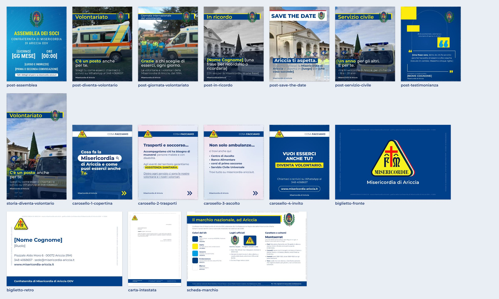

# Modelli grafici nazionali per la Misericordia di Ariccia

Sono i modelli grafici della Confederazione Nazionale delle Misericordie d'Italia, rifatti identici per la Misericordia di Ariccia il 21/10/2026. Vengono dal kit Canva mostrato nei webinar nazionali sulla comunicazione del 2026 e da due post pubblicati sul sito nazionale. Alessandro: *«sono destinate alle associazioni, quindi liberamente compilabili»*.

La cartella non va online: Hugo non pubblica `scripts/`. Quando usarli e come si fa lo dicono `CLAUDE.md` (§ «2. Grafica brand») e la skill `grafiche-modelli-nazionali` (`.claude/skills/grafiche-modelli-nazionali/SKILL.md`, per ChatGPT anche in `.agents/skills/`).

## I modelli

| Modello | Misure | A che cosa serve |
|---|---|---|
| `post-con-fascia.html` | 1080×1350 | Post su un tema (volontariato, Servizio civile, un servizio, un corso): foto piena, fascia blu con il tema e lo stemma, titolo in basso con le prime parole evidenziate |
| `post-con-fascia-due-righe.html` | 1080×1350 | Lo stesso, con il tema su due righe (giornate mondiali e nazionali) |
| `storia-con-fascia.html` | 1080×1920 | Storia di Instagram e Facebook con gli stessi elementi |
| `post-testimonianza.html` | 1080×1350 | Una frase vera di chi fa servizio, con la sua foto scontornata |
| `carosello-copertina.html` | 1080×1350 | Prima pagina di un carosello («Cosa facciamo» o un altro tema) |
| `carosello-pagina.html` | 1080×1350 | Pagina interna del carosello, con paragrafi |
| `carosello-elenco.html` | 1080×1350 | Pagina interna del carosello, con un elenco |
| `carosello-invito.html` | 1080×1350 | Ultima pagina del carosello: domanda, invito e contatti |
| `post-save-the-date.html` | 1080×1350 | Annuncio di una data da segnare |
| `post-assemblea.html` | 1080×1350 | Convocazione dell'assemblea dei soci (carattere Roboto Condensed, come nel post nazionale) |
| `biglietto-fronte.html`, `biglietto-retro.html` | 85×55 mm | Biglietto da visita, in PDF per la tipografia |
| `carta-intestata.html` | A4 | Lettere, in PDF |
| `scheda-marchio.html` | 1600×1000 | Promemoria di colori, loghi, caratteri e schemi |

I campi di ogni modello, con la descrizione, sono nel commento in testa al file e nell'elenco di `python3 .claude/skills/grafiche-modelli-nazionali/rendi.py --elenco`. Gli esempi compilati sono in `esempi/`: quelli con `"bozza": true` hanno ancora campi da riempire o la foto di prova e non si pubblicano. `post-in-ricordo.json` mostra una grafica di lutto.

## Le regole dei modelli

- **Identici agli originali.** Non si cambiano colori, caratteri, misure e posizioni, e non si aggiungono cornici decorative, filigrane o altri loghi. Se un testo non entra, si accorcia il testo: il corpo dei caratteri resta quello del modello. L'unica aggiunta è quella del punto qui sotto.
- **Sempre «Misericordia di Ariccia», con la cornice di microtesto (dal 21/10/2026).** Alessandro: *«metti in ogni slide, documento grafico eccetera sempre Misericordia di Ariccia! Altrimenti ci rubano la grafica!! e se riesci anche un microtesto come filigrana ai bordi a mo' di cornice»*. Ogni modello ha «Misericordia di Ariccia» in un elemento con `data-firma`: la denominazione che il modello nazionale già prevede (assemblea, biglietto, carta intestata, scheda del marchio) oppure una firma piccola in basso, in Montserrat (classe `firma` di `base.css`). `rendi.py` si ferma se la firma manca, se è più piccola di 5 punti in stampa, di 24 px nei formati social larghi 1080 px o di 16 px negli altri, se è trasparente, se esce dalla tavola o dall'area sicura della storia, se tocca un logo o se un testo la copre. Ogni grafica esce poi con la cornice di microtesto: una riga di 9 px su 1080 lungo i quattro bordi con «MISERICORDIA DI ARICCIA · www.misericordia-ariccia.it · grafica della Confraternita di Misericordia di Ariccia ODV · © anno», incisa dal motore `../firma-e-cornice.js` con il tono adattato al fondo, così da lontano non si vede e ingrandendo si legge. Nei modelli da stampa la cornice è testo vettoriale dentro il margine bianco (`<meta name="microtesto">`), solo sul fondo che domina ogni lato. Il motore scrive anche un segno in testa al file (commento nei JPEG, blocco di testo nei PNG), che i controlli del sito cercano nelle grafiche delle news e nelle pagine della Parola della domenica in uscita.
- **Grafiche fatte in altro modo.** Una grafica che non nasce da questi modelli (copertina di un video, design Canva, grafica fatta da un'altra AI) prende la cornice con `rendi.py --cornice FILE…`; con `--firma basso-sinistra` (oppure `basso-centro`, `basso-destra`) aggiunge anche la firma, solo se sotto c'è un fondo uniforme, altrimenti si ferma (`--forza` per scriverla comunque, dopo aver guardato il risultato). I file che hanno già il segno si saltano. Se firma e cornice sono già nei pixel (i fotogrammi dei video della rubrica), `rendi.py --segno FILE…` scrive solo il segno, dopo aver trovato la cornice sui quattro lati. Le grafiche già pubblicate restano come sono.
- **Un solo stile.** Una grafica della Misericordia che non ha un modello si fa partendo dal modello più vicino, con gli stessi colori, caratteri e loghi di questa cartella.
- **Dati come sul sito.** Telefoni, email, indirizzi e codice fiscale si prendono da `hugo.toml` (`[params]`) e dalla pagina Contatti, mai a memoria. Il 348 4068657 è il numero dei servizi, dei trasporti e di WhatsApp; il 328 8105399 è quello dell'amministrazione, delle iscrizioni e del Servizio Civile. Questi file sono nel registro `data/dati_da_verificare.yaml`: se un dato cambia, si corregge anche qui.
- **Foto.** Prima le foto vere della Misericordia. Mai pazienti o persone assistite riconoscibili, mai dati sanitari, targhe, indirizzi o dettagli dei servizi. Volontarie e volontari in primo piano solo con il loro consenso, minori mai riconoscibili senza il consenso dei genitori. La foto di `foto-prova/` (piazza di Corte: è `static/img/hero-piazza.jpg` senza il bordo) serve solo per le prove: lo script la rifiuta in una grafica finale, anche se se ne indica il file o una sua copia.
- **Foto in bianco e nero solo per un lutto.** Sui social il bianco e nero dice che si ricorda una persona morta (Alessandro, 21/10/2026), quindi le foto a colori restano a colori e vanno in bianco e nero solo nelle grafiche in ricordo di un defunto: consorelle e confratelli, volontarie e volontari, benefattori, chi ha fatto parte della vita della Misericordia e i personaggi pubblici che in qualche modo le sono stati vicini, dal Papa in giù; anche l'anniversario della morte, le vittime di una tragedia, la commemorazione dei defunti del 2 novembre. Le foto nate in bianco e nero, come quelle d'archivio, restano come sono. Si chiede con `"lutto": true` nei dati: in grigio va solo la foto, mentre fascia, colori, stemma e testi restano quelli istituzionali. Se il testo sembra ricordare una persona morta e il dato manca, `rendi.py` si ferma e chiede di scegliere (`"lutto": false` se non è un ricordo). Per un personaggio pubblico serve una foto con una licenza che ne permetta l'uso, per esempio da Wikimedia Commons, con l'autore citato nel testo del post.
- **Testimonianza.** La frase è vera, detta da chi la firma, ed esce con il suo consenso scritto, come la sua foto.
- **5×1000.** Si usano le grafiche ufficiali della campagna nazionale già compilate per Ariccia, così come sono: per la campagna 2026 («Non servono superpoteri. Servi Tu.») `static/img/news/5x1000-ambulanza.jpg`, `5x1000-compagnia.jpg`, `5x1000-emporio.jpg` e `5x1000-spesa.jpg`. Per un anno nuovo si controlla prima se la Confederazione ha pubblicato la campagna di quell'anno, e si cambia solo il codice fiscale. `5x1000-grafica.jpg` (una scena del video del 5×1000) e `5x1000-quadrato.jpg` (grafica fatta qui, con il vecchio dominio) sono nello stile precedente e non sono modelli.

## Loghi e caratteri

- `loghi/stemma-misericordie.png` e `loghi/triangolo-misericordie.png` sono ritagli esatti, pixel per pixel, del file ufficiale della Confederazione [`logo-doppio.png`](https://www.misericordie.it/wp-content/uploads/2024/08/logo-doppio.png) (2388×1242): lo stemma è il riquadro 948×1145 che parte da x 167, y 46; il triangolo il riquadro 1112×934 che parte da x 1243, y 118. Non si ridisegnano, non si ricolorano, non si deformano. Il triangolo di `static/img/loghi/mise-triangolo.png`, usato dal sito, è un'altra versione, con un giallo più scuro: nei modelli nazionali si usa quello ufficiale di questa cartella.
- `font/`: Montserrat e Roboto Condensed (caratteri variabili, alfabeto latino ed esteso), licenza SIL Open Font License 1.1 (testi in `font/OFL-*.txt`), dai file di Google Fonts. Sono qui perché il disegno venga uguale su ogni computer.

## Come sono fatti (per chi li modifica)

- `base.css`: caratteri, colori (`--blu` #003F85, `--giallo` #FCEB0C; la cancelleria usa il blu di stampa #003F8A), le classi dei campi HTML (`evidenzia` per il fondo giallo, `sottolinea`, `finale` per la parola gialla sottolineata della copertina) e la regola del lutto (`body.lutto`: solo le immagini con `data-campo` in bianco e nero, mai i loghi).
- Firma e cornice: `data-firma` sull'elemento con «Misericordia di Ariccia» (classe `firma` di `base.css`, o la scritta già prevista dal modello), `<meta name="microtesto" content="margine=…mm corpo=…mm lati=…">` nei modelli da stampa. Il motore è in `../firma-e-cornice.js` (pagina `../firma-e-cornice.html`, usata da `rendi.py` e dalla Parola della domenica); la prova del controllo del sito è `scripts/controlli/prova_cornice.py`.
- Attributi: `data-campo` (campo da riempire; con `data-html` accetta un po' di HTML, con `data-elenco` una voce per riga), `data-riquadro` (spazio che il testo non deve superare), `data-logo` e `data-ostacolo` (parti che i testi non devono toccare), `data-prova` (foto di prova), `data-segnaposto-di` (segnaposto che sparisce quando arriva la foto).
- Intestazione: `<meta name="formato">` con le misure in pixel, `<meta name="area-sicura">` nella storia, `<meta name="stampa">` nei modelli da stampare in PDF.
- Le misure vengono dai fotogrammi dei webinar W1 e W3 e dai post nazionali a piena risoluzione, con uno scarto di qualche pixel: con il kit Canva originale si allineano esattamente.
- Dopo una modifica: `python3 .claude/skills/grafiche-modelli-nazionali/rendi.py --autotest`, poi rifare l'anteprima con `rendi.py --esempi CARTELLA_DI_PROVA --anteprima scripts/grafica-brand/modelli-nazionali/anteprima.jpg` e guardarla.
